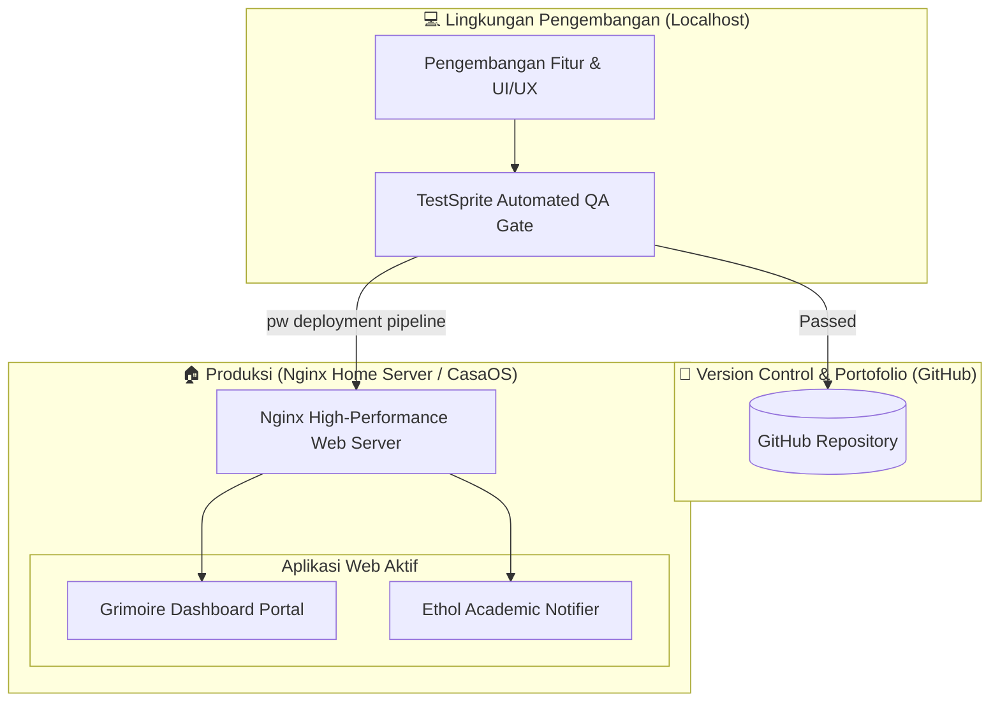

# 🌌 Arz-WEB: Self-Hosted Cloud Ecosystem & Micro-Apps

[](https://github.com)
[](https://github.com)
[](https://github.com)
[](https://github.com)
[](https://github.com)

> **Arz-WEB** adalah ekosistem aplikasi web mandiri (*self-hosted cloud micro-apps*) yang dirancang dengan filosofi performa tinggi (*zero-framework overhead*), estetika visual modern (*glassmorphism & dark aura*), dan integrasi penuh dengan server produksi rumah (Nginx di atas CasaOS).

---

## 🏛️ Arsitektur Ekosistem & Alur Kerja

Ekosistem Arz-WEB menghubungkan lingkungan staging lokal, version control terpusat di GitHub, dan penyajian produksi berkecepatan tinggi di server web rumah:



---

## 🌟 Pilar Aplikasi Utama (Core Micro-Apps)

### 1. 🔮 Personal Web & Operations Dashboard (`index.html`)
*Portal Pusat Kendali, Portofolio & Peluncur Layanan Mandiri*
- **Fitur Utama:**
  - **Persona 3 Reload Aesthetic & Video Replica:** Antarmuka visual interaktif bertema Persona dengan navigasi menu video dinamis (Home, About, Projects, Skills, Contact) dan zoom-lock 80%.
  - **Dynamic Project Catalog:** Katalog ubin proyek interaktif dengan pelacakan status operasional dua fase (*Aktif* & *Perbaikan*).
  - **Live Service Health Monitor:** Pelacak ketersediaan dan latensi node layanan secara real-time.
  - **Interactive Widget Suite:** Jam astronomis, audio ambience switcher, dan quick console.
  - **Aura & Glassmorphism Design:** Tampilan modern dengan efek frosted glass, gradient glow, dan micro-interaction responsif.

### 2. 🎓 Ethol Academic Notifier (`ethol-notifier/`)
*Executive Presensi Deck & Asisten Akademik Otonom Berkinerja Tinggi*
- **Fitur Utama:**
  - **High-Performance Direct API Engine (Zero-Browser):** Mengadopsi arsitektur daemon Go (`repinger/ethold`) dengan eksekusi direct CAS SSO dan ETHOL REST API murni, memangkas RAM ke < 30MB dan mempercepat siklus eksekusi dari 30s ke ~2.3 detik.
  - **Atomic State Persistence (`attended_keys.json`):** Sistem penguncian state presensi otomatis dengan retensi 90 hari untuk mencegah duplikasi submission.
  - **Executive Presensi Deck:** Radial SVG progress ring countdown yang dinamis, kartu identitas mahasiswa, dan status engine reaktif.
  - **Activity Feed Timeline:** Linimasa presensi interaktif real-time menggantikan konsol mentah, dilengkapi kartu detail kehadiran dan verifikasi status.
  - **Dynamic Theme Metamorphosis & Resilient Loop:** Transisi warna halus (*0.8s transition*) dari Obsidian Cyan ke Velvet Crimson Arcane saat mode pengawasan loop aktif dengan auto-reschedule error resilience dan sinkronisasi kredensial privat CasaOS.
  - **Collapsible Server Diagnostics:** Konsol teknis terintegrasi di tray drawer bawah yang dapat dilipat agar fokus antarmuka tetap bersih.
  - **Concurrent Task Scraper & Modular CLI Engine:** Sinkronisasi penugasan perkuliahan paralel portal ETHOL PENS (jendela waktu -7 hari s/d +30 hari & filter status selesai ketat) dengan dukungan flag pemindaian modular (`--tasks-only`, `--absen-only`) yang tersimpan otomatis di `tasks.json`.
  - **Multi-Node Fallback Gateway & PWA Ready:** Gerbang proxy failover otomatis dan dukungan Progressive Web App untuk perangkat mobile.
  - **Mobile-First & Anti-Scroll Trap Engine:** Antarmuka responsif ramah jempol (100dvh & safe area insets), tata letak grid adaptif seimbang, dan eliminasi total scroll trap untuk pengalaman browsing smartphone yang mulus.

### 3. 🔬 Lab & Visual Inspector (`lab/` — Localhost Sandbox)
*Laboratorium Visualisasi & Sandbox Pengujian Eksklusif Localhost*
- **Visual Absen Inspector (`lab/proses-absen/`):** Platform observasi visual alur automasi presensi Ethol step-by-step (CAS login, form filling, validasi sesi, panel lonceng, filter 24 jam, klik kehadiran, dan histori screenshot).
- **TestSprite Sentinel Hub (`testsprite_tests/`):** Pemantau pengujian otonom dual-suite (Playwright & REST API) dengan brankas 15 akun token dan auto-healing runner.

---

## 🛠️ Stack Teknologi & Keunggulan Rekayasa

| Komponen | Teknologi | Alasan Pemilihan & Keunggulan |
| :--- | :--- | :--- |
| **Frontend Core** | Vanilla HTML5, Modern CSS3, ES6+ JavaScript | Kecepatan render instan tanpa beban bundle compiler (*zero virtual DOM lag*). |
| **Styling & UI** | CSS Custom Properties, Glassmorphism, CSS Grid/Flexbox | Desain konsisten, modular, adaptif layar mobile (~360px - 480px), dan ramah sentuhan jempol. |
| **Gateway & Backend** | PHP 8+ / Node.js Microservices | Performa ringan untuk gateway routing, webhook dispatcher, dan handling file data. |
| **Web Server** | Nginx on CasaOS (Linux Home Server) | Distribusi aset statis dengan kompresi gzip/brotli dan latensi minimal melalui Tailscale VPN. |
| **QA Automation** | TestSprite E2E & Autonomous Test Runner | Memastikan zero-regression sebelum kode dipindahkan ke server publik. |

---

## 📱 Mobile-First & Touch Ergonomics

Seluruh antarmuka ekosistem dirancang dengan prinsip ergonomi mobile yang ketat:
- **Zero Horizontal Overflow:** Jaminan `max-width: 100vw; overflow-x: hidden;` bebas glitch layout.
- **Thumb-Friendly Touch Targets:** Tombol aksi utama memiliki target sentuh minimal 40px – 48px untuk kemudahan navigasi satu tangan.
- **Scrollable Data Containers:** Seluruh tabel data dibungkus dalam wadah horizontal scroll adaptif untuk kenyamanan membaca di layar kecil.

---

## 🚀 Panduan Menjalankan Secara Lokal (Quick Start)

### Prasyarat
- [Node.js](https://nodejs.org/) (versi 18+)
- Web Browser modern (Chrome, Edge, Firefox, Safari)

### Langkah Menjalankan
1. **Clone repositori ini:**
   ```bash
   git clone https://github.com/RadenArya1/Arz-WEB.git
   cd Arz-WEB
   ```

2. **Jalankan server lokal staging:**
   ```bash
   npm start
   # atau
   node serve.js
   ```

3. **Buka antarmuka di peramban:**
   - Grimoire Dashboard: `http://localhost:8080`
   - Ethol Notifier: `http://localhost:8080/ethol-notifier`

---

## 🔒 Kebijakan Keamanan & Privasi

- **Zero-Leak Test Tokens:** Seluruh berkas vault autentikasi pengujian lokal dan kredensial otomatis diabaikan oleh Git via `.gitignore`.
- **Private Gateway Endpoints:** Komunikasi data antar-node dilindungi oleh enkripsi jaringan privat Tailscale.

---

## 👨‍💻 Pengembang & Portofolio

Dikembangkan oleh **Raden** sebagai bagian dari portofolio rekayasa web *Full-Stack* & *Self-Hosted Systems Architecture*.

[](https://github.com/RadenArya1)
[](http://localhost:8080)
